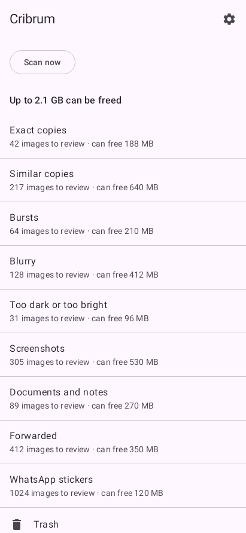
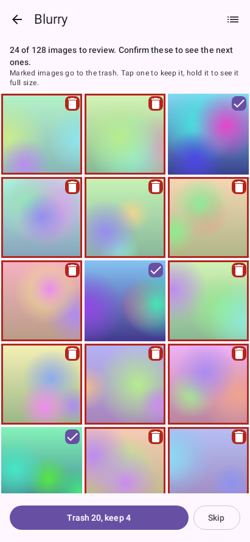
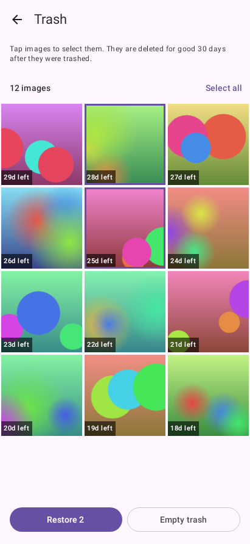

# Cribrum

Website: https://cribrum.bertons.me

*Cribrum* is Latin for "sieve" (Italian: *crivello*).

Cribrum finds the images on your device that you can delete without losing memories that matter: blurry shots, duplicates and lower-resolution copies, photos of lecture slides and homework, screenshots, and the media that messaging apps such as WhatsApp scatter across storage.

It **suggests** and you **decide**. Nothing is ever deleted without your confirmation, and deleted images go to a trash first, so you can still restore them.

## What it does

Cribrum is an Android app. It scans the whole storage, folders hidden from the gallery included, and groups the images you might want to delete into categories:

- exact copies, similar copies and bursts, with the best copy marked to keep;
- blurry images, and images that are too dark or too bright;
- screenshots, documents and notes, forwarded media, and WhatsApp stickers.

You open a category and see a grid with the likely deletable images already marked. Tap an image to keep it, hold it to see it at full size and why it was suggested, then confirm a summary. The images go to Cribrum's own trash, which keeps them for 30 days by default (7 to 90 in the settings) and restores them to their original path. A file is deleted for good only when its time runs out or you empty the trash.

<table>
  <tr>
    <td></td>
    <td></td>
    <td></td>
  </tr>
</table>

The images in the screenshots are drawn in code, and the counts are made up.

## Status

The app is usable. It needs Android 11 or newer and the "All files access" permission, and it is distributed as an APK you sideload, not through the Play Store. Download one from the [releases page](https://github.com/Bert0ns/cribrum/releases). The scan runs once a night while the phone charges, or when you tap "Scan now".

The detectors are tuned on one person's library, so expect some wrong suggestions and some misses. Cloud libraries such as Google Photos, iOS and desktop are not covered.

## Principles

- **Practical over pretty.** A clean, minimal UI whose features actually work.
- **Recall over precision.** Surfacing an image that turns out to be worth keeping is fine. Missing one that could have been deleted is not.
- **Private by design.** All analysis runs on the device. No image ever leaves it.
- **Nothing is lost by accident.** Every deletion is confirmed and reversible for 30 days by default.

## Repository layout

| Path | Contents |
|---|---|
| [`docs/design.md`](docs/design.md) | Design document: goals, decisions, architecture, roadmap |
| [`lab/`](lab/) | Python lab: reference implementation of the detectors, with the tools to label and measure them |
| [`android/`](android/) | Android app (Kotlin + Jetpack Compose) |
| [`fixtures/`](fixtures/) | Synthetic golden images that check the lab and the app agree |
| [`site/`](site/) | The website |

## Roadmap

The next steps are in [`docs/design.md`](docs/design.md#11-future-work-and-open-questions), section 11. The main ones are learning each category's threshold from your keep and trash decisions, a single recall setting in place of one slider per category, and offering to compress an image instead of deleting it.

## Build and test

From `lab/`:

```bash
uv run ruff check && uv run ruff format --check && uv run pytest
```

From `android/` (JDK 21 and the Android SDK):

```bash
./gradlew ktlintCheck testDebugUnitTest lintDebug assembleDebug
```

[`AGENTS.md`](AGENTS.md) has the rest for contributors, and [`android/README.md`](android/README.md) covers installing a build on a phone.

## License

Cribrum is free software, released under the [GNU General Public License v3.0](LICENSE). You may use, study, modify, and share it. If you distribute a modified version, it must be released under the same license.
