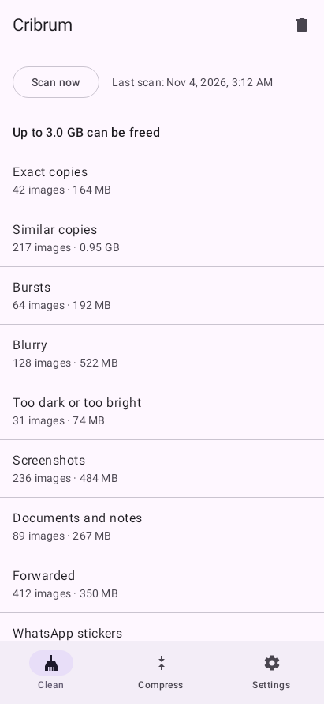
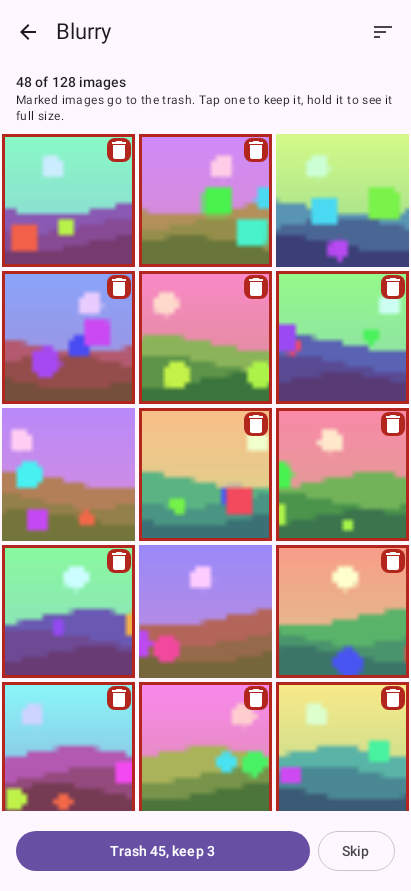
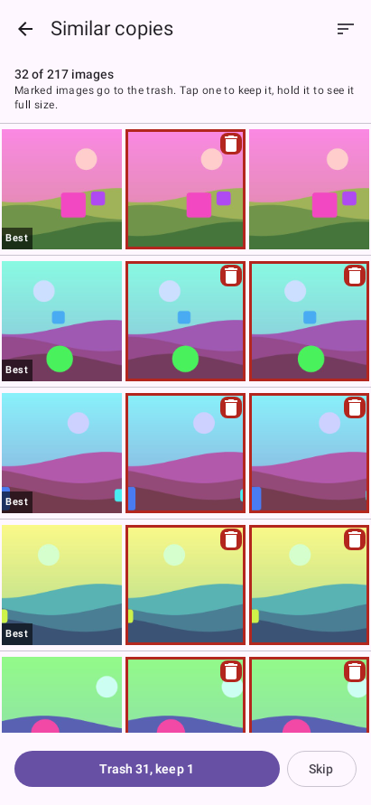
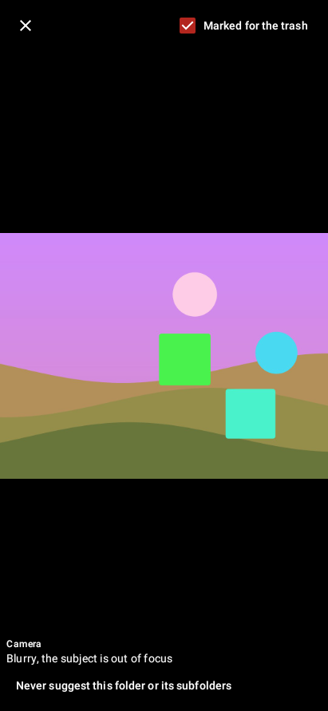
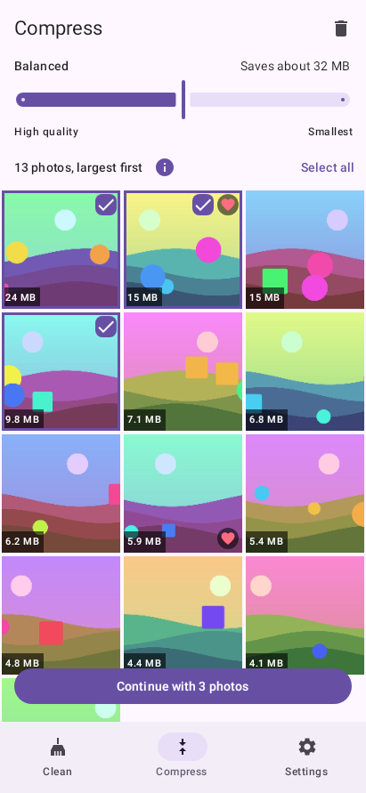
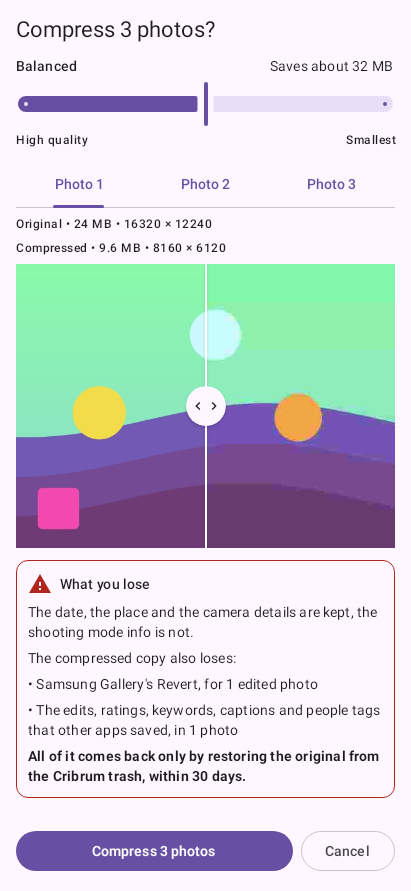
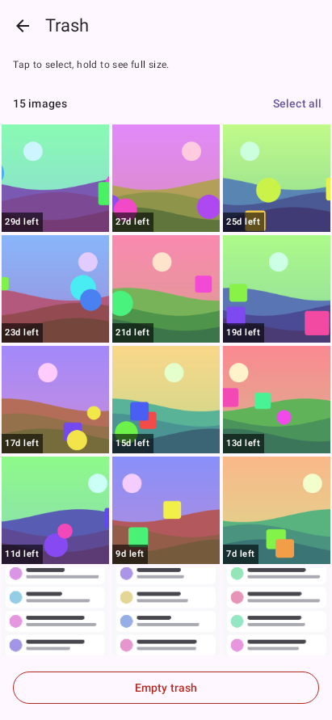
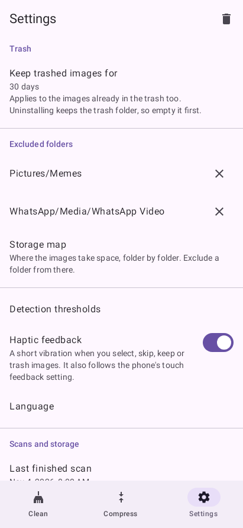
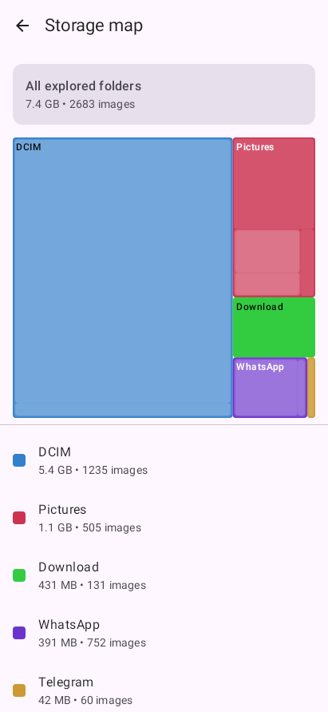

# Cribrum

Website: https://cribrum.bertons.me

*Cribrum* is Latin for "sieve" (Italian: *crivello*).

Cribrum finds images on your device that you can delete or recompress without losing memories that matter: blurry shots, duplicate copies, burst sequences, photos of lecture slides and notes, screenshots, and media scattered by messaging apps.

It suggests and you decide. Nothing is deleted without confirmation. Deleted images move to a local trash folder first, so you can restore them at any time during the retention window.

## What it does

Cribrum is an Android app that inspects device storage, including folders marked with `.nomedia` that system gallery apps skip. It groups candidate images into clear categories for review, offers safe JPEG recompression for large camera photos, and gives you a visual storage map to track space usage.

The detectors are tuned on one person's library, so expect some wrong suggestions and some misses. Cloud libraries such as Google Photos, iOS and desktop are not covered.

## Features

### Categories and cleanup

The Clean screen summarizes how much storage you can free across nine categories:

- **Exact copies.** Identical files matched byte-for-byte with xxHash3-64 in the group detection phase.
- **Similar copies.** Recompressed, resized, or edited copies found with 64-bit DCT perceptual hashes (pHash) and MobileCLIP image embeddings.
- **Bursts.** Photos taken in rapid succession within three seconds of each other.
- **Blurry.** Images with low Laplacian sharpness on subject areas, while keeping intentional portrait blur.
- **Too dark or too bright.** Pocket shots, black frames, and overexposed images identified by luminance histograms.
- **Screenshots.** Screen captures detected by directory path, display dimensions, and missing camera metadata.
- **Documents and notes.** Slides, whiteboards, handwritten notes, receipts, and printed pages detected with PP-OCRv4 text detection and zero-shot image classification.
- **Forwarded.** Memes and graphics in messaging folders that lack camera metadata.
- **WhatsApp stickers.** Files located in WhatsApp sticker folders across storage.

Each category opens into a grid with suggested deletions already marked. You can tap an image to keep it, hold it to inspect the image at full size with the reasons it was flagged, or change the sorting order. The main button under the grid moves marked images to Cribrum's trash immediately, accompanied by an undo snackbar.

### Duplicate and burst groups

Exact duplicates, similar copies, and burst shots appear in grouped views. The app picks the best copy to keep, such as the highest resolution file or the sharpest shot. You review the copies side by side, swap which copy to keep, or mark copies for trash.

### Photo compression

Instead of deleting photos, the Compress tab lets you recompress large camera JPEGs to reclaim storage space.

- **Three quality levels.** High quality uses JPEG 90 at original resolution. Balanced uses JPEG 85 and scales down photos larger than 50 MP, cutting file size roughly in half with little visible change. Smallest files uses JPEG 80 and scales down photos larger than 12 MP.
- **Split comparison slider.** An interactive split handle lets you compare the original image against the recompressed result before confirming, with deep zooming down to individual pixels.
- **Preserved metadata.** Recompressed copies preserve standard EXIF tags (date taken, camera details, lens info, orientation), GPS coordinates, and Ultra HDR gain maps on Android 14 and newer. Original XMP (except new gain map data on Ultra HDR), Samsung SEF trailers, C2PA content credentials, IPTC data, EXIF thumbnails, and shooting mode info are not preserved, and custom maker notes are not guaranteed. The original photo moves to the trash, where it can be restored with all metadata intact within the retention window.
- **Reversible originals.** Original photos move to Cribrum's trash folder. You can undo the entire compression batch from the summary screen or restore individual originals later.
- **Background batches.** Batches run in the background with progress notifications and pause when the device reaches severe heat.

### Trash and undo

Applying a review page moves deleted files to Cribrum's trash folder on shared storage and shows an immediate undo snackbar.

- **Retention window.** The trash keeps deleted files for 30 days by default, configurable from 7 to 90 days in settings.
- **Restoration.** Restoring a photo returns it to its original directory path.
- **Automatic cleanup.** Files are permanently removed only after their retention period expires or when you empty the trash manually.

### Favourites and protection

- **Gallery favourites.** Photos marked as favourites in your gallery show a heart badge and start unticked.
- **Confirmation.** If you choose to trash a favourite, the app asks for confirmation before moving it.
- **Recall over precision.** Protections never hide candidates from review. Instead, they demote protected images in the ranking order so you remain in control.

### Background scans

Cribrum runs an incremental scan automatically once a night at 02:00 while the phone charges, or whenever you tap "Scan now". The app indicates when the phone is hot enough to slow the scan down, though scan work itself does not throttle or pause for heat. Only photo compression batches pause when the device reaches severe heat.

### Settings and storage map

The Settings screen provides configuration and diagnostics:

- **Storage map.** An interactive treemap displays storage consumption across folders. You can tap a block to inspect its size and file count, zoom into subfolders, or exclude an entire folder from future scans.
- **Trash retention.** Select 7, 14, 30, 60, or 90 days before automatic deletion.
- **Detection thresholds.** Sliders adjust detection sensitivity for each category, showing live candidate counts as you move them.
- **Folder exclusions.** View and manage directories excluded from review.
- **Haptics.** Toggle vibration feedback for selection and review actions.

## Screenshots

<table>
  <tr>
    <td></td>
    <td></td>
    <td></td>
  </tr>
  <tr>
    <td></td>
    <td></td>
    <td></td>
  </tr>
  <tr>
    <td></td>
    <td></td>
    <td></td>
  </tr>
</table>

The images in the screenshots are drawn in code, and the counts are made up.

## Technical architecture

Cribrum performs all scanning, inference, and file operations directly on the device. It has no network permissions.

### Signals and ranking

Analysis runs as a pipeline where individual detectors emit `Signal` values with confidence scores. The `Ranker` combines these signals into ordered candidate lists:

- **Recall over precision.** Surfacing a photo that turns out to be worth keeping is acceptable. Missing clutter that the user wanted to delete is not.
- **Protections reorder without dropping.** Signals like faces, favourites, and albums reduce candidate priority rather than filtering images out. This leaves the final decision to the user while keeping important items safe from accidental deletion.

### On-device models

The app bundles three local neural models:

- **MobileCLIP2-S0.** A 45 MB float32 image encoder (MCi0) running on ONNX Runtime. It generates 512-dimensional embeddings used for similar photo clustering, zero-shot document identification, and meme detection. Prompt embeddings for text queries are precomputed in the Python lab and stored as JSON in the APK assets, avoiding on-device text tokenization.
- **YuNet.** A 230 KB ONNX face detection model. It locates faces and facial landmarks to protect portraits.
- **PP-OCRv4.** An ONNX text detection model that measures the proportion of an image covered by text lines, identifying slides, documents, and paper receipts.

Models run through ONNX Runtime with CPU fallback and hardware acceleration where supported.

### Storage index and scan worker

- **Room database.** A SQLite database tracks file metadata, content hashes, perceptual hashes, embeddings, and emitted signals.
- **Six-phase incremental scan.** Scans run through six phases ([`docs/design.md §4, §7`](docs/design.md)): (1) filesystem walk ("Looking for images"), (2) metadata extraction ("Reading the images"), (3) non-embedding detectors ("Analyzing the images": `BLURRY`, `BAD_EXPOSURE`, `SCREENSHOT`, `FACES`, `STICKER`, and 64-bit DCT pHash), (4) embedding generation ("Comparing the images"), (5) embedded detectors ("Classifying the images": `DOCUMENT` with PP-OCRv4 text coverage, and `FORWARDED`), and (6) group detectors ("Finding duplicates and bursts": exact duplicates with xxHash3-64, near duplicates with DCT pHash and embeddings, and bursts). Files with unchanged size and modification timestamps skip earlier phases.
- **WorkManager.** `IndexWorker` manages nightly scans at 02:00 when connected to power, running within a 00:00–06:00 window and rescheduling for the next night if skipped.

### Python lab and parity

The `lab/` directory contains the Python reference implementation for all detectors, ranking algorithms, and data structures.

- **Component mirroring.** Python modules in `cribrum_lab` mirror Kotlin packages in `io.github.bert0ns.cribrum` with matching names and type contracts.
- **Golden test fixtures.** The `fixtures/golden/` directory holds synthetic test images. Both the Python test suite and Android unit tests evaluate these fixtures through their respective image decoders to verify that detector scoring and rankings agree.
- **Parity verification.** Running `python3 lab/scripts/check_parity.py` statically checks that detector IDs, versions, thresholds, protection weights, and numeric constants match between Python and Kotlin.

## Build and verification

### Android app

Prerequisites: JDK 21 and the Android SDK.

To check code formatting, run unit tests, run Android lint, build the debug APK, and compile baseline profiles:

```bash
cd android
./gradlew ktlintCheck testDebugUnitTest lintDebug assembleDebug :baselineprofile:compileNonMinifiedReleaseKotlin
```

To render the README and website screenshots:

```bash
./gradlew -PreadmeScreenshots testDebugUnitTest --tests '*ReadmeScreenshots'
```

### Python lab

Prerequisites: Python 3.12 and [uv](https://docs.astral.sh/uv/).

```bash
cd lab
uv run ruff check
uv run ruff format --check
uv run pytest
```

### Parity verification

From the repository root:

```bash
python3 lab/scripts/check_parity.py
```

[`AGENTS.md`](AGENTS.md) has the complete instructions for contributors (including shared cache locking and required JDK 21), and [`android/README.md`](android/README.md) covers installing a build on a phone.

## Status and requirements

- **Android version.** Android 11 (API 30) or newer. Android 11 introduced the scoped storage rules and `MANAGE_EXTERNAL_STORAGE` permission that Cribrum relies on.
- **Permissions.** Requires "All files access" to inspect directories outside MediaStore, such as WhatsApp `.nomedia` media folders, and to manage the trash directory. Cribrum explicitly removes the `android.permission.INTERNET` permission in its manifest.
- **Distribution.** Sideloaded APK available from the [GitHub releases page](https://github.com/Bert0ns/cribrum/releases). Not distributed on Google Play because of storage access policy restrictions.

## Principles

- **Practical over pretty.** A clean, minimal UI whose features actually work.
- **Recall over precision.** Surface potential candidates for the user to review. Missing clutter is worse than asking about a keeper.
- **Private by design.** All processing stays on your device. The app cannot make network connections.
- **Nothing is lost by accident.** Every deletion and compression is confirmed and reversible through Cribrum's trash folder.

## Repository layout

| Path | Contents |
|---|---|
| [`docs/design.md`](docs/design.md) | Design document: goals, decisions, architecture, roadmap |
| [`lab/`](lab/) | Python lab: reference implementation of detectors and labeling tools |
| [`android/`](android/) | Android app: Kotlin and Jetpack Compose codebase |
| [`fixtures/`](fixtures/) | Golden test images used for parity verification |
| [`site/`](site/) | Website source files |
| [`docs/screenshots/`](docs/screenshots/) | Rendered application screenshots |

## Roadmap

The next steps are in [`docs/design.md`](docs/design.md#11-future-work-and-open-questions), section 11. The main ones are learning each category's threshold from your keep and trash decisions, and a single recall setting in place of one slider per category.

## License

Cribrum is free software, released under the [GNU General Public License v3.0](LICENSE).
